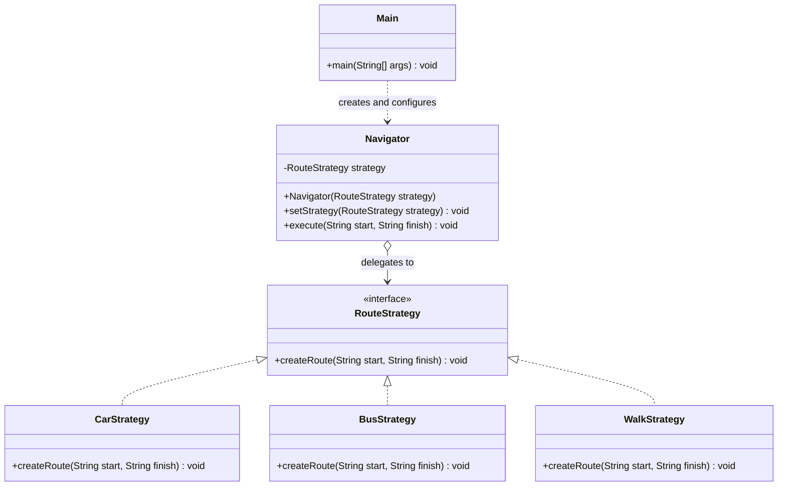

# Assignment #5 — Strategy Pattern

**Course:** ShP-2216 — Software Design Patterns  
**Program:** 6B06102 — Software Engineering  
**Institution:** Astana IT University, School of Software Engineering  
**Academic year:** 2026–2027  
**Student:** Amanzhol Yerzhanov  
**Group:** SE-2526  

## 1. Introduction

This project demonstrates the Strategy behavioral design pattern through a simple navigation system. The system supports three interchangeable route-creation strategies: travelling by car, travelling by bus, and walking.

The main problem addressed by the Strategy pattern is how to support several variants of an operation without placing transport-specific conditional logic inside one large class. In this implementation, the `RouteStrategy` interface defines a common operation, `createRoute(String start, String finish)`. The concrete classes `CarStrategy`, `BusStrategy`, and `WalkStrategy` implement this operation independently.

The `Navigator` class acts as the Context. It stores a reference to a `RouteStrategy` and delegates route creation to the selected implementation. The strategy can be changed at runtime using `setStrategy()`. The `Main` class acts as the Client: it creates a navigator, executes a route using a car strategy, and then switches to walking and bus strategies.

The current implementation is a demonstration of the pattern rather than a complete navigation application. The strategies print route descriptions to the console; they do not calculate real routes, distances, or travel times.

## 2. UML Class Diagram



### Class responsibilities

- **`RouteStrategy`** — defines the common interface for route-creation algorithms.
- **`CarStrategy`** — implements the car route variant.
- **`BusStrategy`** — implements the bus route variant.
- **`WalkStrategy`** — implements the walking route variant.
- **`Navigator`** — stores the selected strategy, allows it to be changed, and delegates execution to it.
- **`Main`** — configures the navigator and demonstrates switching strategies at runtime.

The three concrete strategies implement the same interface, so `Navigator` can work with any of them without depending on their specific classes.

## 3. Clean Code Principles

### 3.1. Polymorphism instead of conditional logic

A common alternative would be to place all route variants in one method and select between them using `if`/`else` or `switch` statements. This would make the Context responsible for knowing every transport type. In this implementation, `Navigator` delegates the operation to the strategy interface:

```java
public void execute(String start, String finish) {
    strategy.createRoute(start, finish);
}
```

**Why this is useful:** `Navigator` does not need a conditional branch for each transport mode. The selected object's implementation determines which behavior runs.

### 3.2. Meaningful, intention-revealing names

The names `RouteStrategy`, `CarStrategy`, `BusStrategy`, `WalkStrategy`, `Navigator`, and `setStrategy()` communicate the roles of the types and methods.

For example:

```java
public class BusStrategy implements RouteStrategy {
    @Override
    public void createRoute(String start, String finish) {
        System.out.println("Creating route strategy by bus from "
                + start + " to " + finish);
    }
}
```

**Why this is useful:** A reader can understand the purpose of the class without needing to inspect a large conditional statement or decipher vague names.

### 3.3. Single Responsibility Principle

Each concrete strategy represents one route-creation variant. For example, `CarStrategy` contains the behavior for the car option, while `BusStrategy` and `WalkStrategy` contain their own variants. `Navigator` has a separate responsibility: delegating execution to the selected strategy.

```java
public class CarStrategy implements RouteStrategy {
    @Override
    public void createRoute(String start, String finish) {
        System.out.println("Creating route by car from "
                + start + " to " + finish);
    }
}
```

**Why this is useful:** Changes to one transport-specific implementation can be made in its own class instead of modifying a central class that contains every algorithm.

### 3.4. Program to an interface and reduce coupling

`Navigator` stores a reference to the `RouteStrategy` interface instead of a reference to `CarStrategy`, `BusStrategy`, or `WalkStrategy` specifically:

```java
private RouteStrategy strategy;

public Navigator(RouteStrategy strategy) {
    this.strategy = strategy;
}
```

**Why this is useful:** The Context depends on the shared contract, not on a particular implementation. Any class that correctly implements `RouteStrategy` can be supplied to the navigator.

### 3.5. Extensibility through the Open/Closed Principle

A new transport option can be introduced by implementing `RouteStrategy`. For example, a future `CycleStrategy` could implement `createRoute()` for cycling. The existing `Navigator` does not need to be changed because it already accepts any `RouteStrategy` implementation.

The Client can select a new strategy in the same way as the existing ones:

```java
navigator.setStrategy(new CycleStrategy());
navigator.execute("Home", "Park");
```

This excerpt illustrates the intended extension; `CycleStrategy` is not currently included in the submitted source files.

**Why this is useful:** Adding a new algorithm does not require adding another branch to `Navigator` or changing the existing concrete strategies.

### 3.6. Runtime configuration is separated from execution

The Client chooses the strategy, while the Context executes it. `Main` demonstrates this separation:

```java
Navigator navigator = new Navigator(new CarStrategy());
navigator.execute("Home", "Uni");

navigator.setStrategy(new WalkStrategy());
navigator.execute("Home", "Park");

navigator.setStrategy(new BusStrategy());
navigator.execute("Uni", "Work");
```

**Why this is useful:** The same `Navigator` instance can use different algorithms during one program execution. Strategy selection is not hard-coded into the Context's `execute()` method.

## 4. Strategy vs. State

Strategy and State can both use composition and delegate behavior through an interface, but they address different design problems. Strategy encapsulates interchangeable algorithms and lets the Client choose which one to use. State models an object's behavior as it changes according to its internal state and state transitions.

This project calls for Strategy because the navigation algorithm is selected explicitly by the Client: the program starts with `CarStrategy` and later switches to `WalkStrategy` and `BusStrategy` through `setStrategy()`. The navigator does not represent a lifecycle of internal states that automatically change its behavior. Therefore, Strategy is a better fit for this problem.

## 5. Conclusion

The project demonstrates how the Strategy pattern separates a family of interchangeable behaviors behind a common interface. The `Navigator` Context delegates route creation to the selected strategy and supports changing that strategy at runtime. This avoids transport-specific conditional logic in the Context and makes it possible to add new variants without modifying the existing navigator.

The main trade-off is that the design introduces additional classes and an interface compared with a single method containing all variants. For a small example, that adds some structure; however, it also improves separation of responsibilities and extensibility as the number of strategies grows. The current project focuses on the design pattern itself, so implementing real route calculations, input validation, and unit tests would be possible future improvements.

## 6. GitHub Repository

https://github.com/93rdmogila/strategy-pattern-studying-project

## References

1. Astana IT University. *Assignment #5 — Strategy Pattern*, course ShP-2216 — Software Design Patterns, academic year 2026–2027.
2. Freeman, E., & Robson, E. (2021). *Head First Design Patterns* (2nd ed.), Chapter 1: Strategy.
3. Martin, R. C. (2008). *Clean Code: A Handbook of Agile Software Craftsmanship*, Chapter 10.
4. Refactoring.Guru. *Strategy Design Pattern*. https://refactoring.guru/design-patterns/strategy

