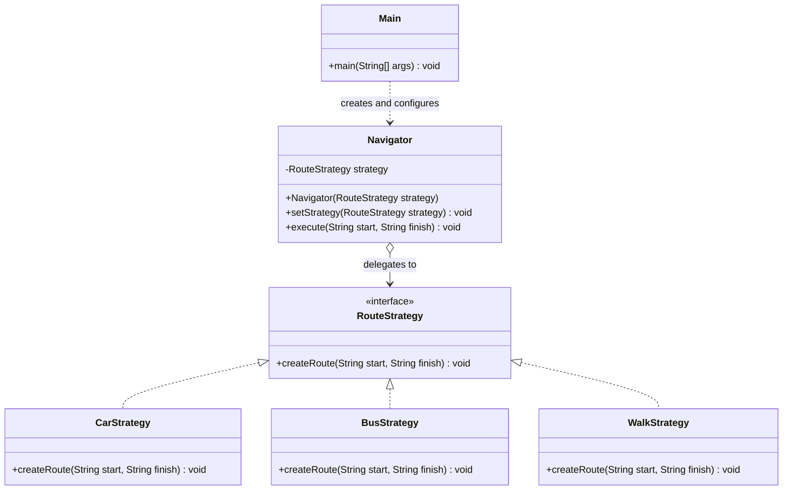

# Strategy Pattern — Navigation System

An individual assignment for **ShP-2216 — Software Design Patterns** at Astana IT University, academic year 2026–2027.

**Author:** Amanzhol Yerzhanov  
**Group:** SE-2526  
**Language:** Java (JDK 17 or later)

## 1. Overview

This project demonstrates the **Strategy behavioral design pattern** using a simple navigation system. A `Navigator` can build a route using one of several interchangeable transportation strategies:

- `CarStrategy` — travel by car
- `BusStrategy` — travel by bus
- `WalkStrategy` — travel on foot

The strategy can be changed while the program is running. `Navigator` delegates route creation to the currently selected strategy through the shared `RouteStrategy` interface, instead of containing `if`/`else` or `switch` statements for each transport type.

> **Scope:** This is a design-pattern demonstration. The current strategies print a message to the console; they do not calculate real routes, distances, travel times, or directions.

## 2. How the Strategy Pattern Works

1. `RouteStrategy` declares the common `createRoute(start, finish)` operation.
2. Each concrete strategy implements that operation for a different transport mode.
3. `Navigator` (the **Context**) stores a reference to a `RouteStrategy` and delegates route creation to it.
4. `Main` (the **Client**) creates the navigator, chooses a strategy, and switches strategies at runtime using `setStrategy()`.

### UML Class Diagram



## 3. Project Structure

```text
StrategyPattern/
├── RouteStrategy.java
├── CarStrategy.java
├── BusStrategy.java
├── WalkStrategy.java
├── Navigator.java
├── Main.java
├── README.md
└── Assignment_5_Strategy_Pattern_2026-2027.pdf
```

- `RouteStrategy.java` — common interface for all route strategies.
- `CarStrategy.java` — route creation by car.
- `BusStrategy.java` — route creation by bus.
- `WalkStrategy.java` — route creation on foot.
- `Navigator.java` — Context that delegates execution to the selected strategy.
- `Main.java` — Client and application entry point.
- `README.md` — project documentation.

The Java source files currently use the default package, so compile and run them from the directory containing the `.java` files.

## 4. Requirements

- JDK 17 or later
- A terminal / command prompt, or an IDE such as IntelliJ IDEA

Check that Java is installed:

```bash
java -version
javac -version
```

Both commands should report a supported JDK version.

## 5. Build and Run

### Windows (PowerShell or Command Prompt)

Open a terminal in the project directory — the directory containing `Main.java` — and run:

```powershell
javac *.java
java Main
```

### macOS / Linux

Open a terminal in the project directory and run:

```bash
javac *.java
java Main
```

The project has no external library dependencies or build-tool requirements. Compilation generates `.class` files beside the source files.

### Expected Output

```text
Creating route by car from Home to Uni
Creating route strategy by walk from Home to Park
Creating route strategy by bus from Uni to Work
```

The output corresponds to the current console messages in the strategy classes. The first call uses `CarStrategy`, the second switches to `WalkStrategy`, and the third switches to `BusStrategy`.

## 6. Runtime Strategy Switching

`Main.java` demonstrates switching strategies without creating a different navigator for each transport type:

```java
Navigator navigator = new Navigator(new CarStrategy());
navigator.execute("Home", "Uni");

navigator.setStrategy(new WalkStrategy());
navigator.execute("Home", "Park");

navigator.setStrategy(new BusStrategy());
navigator.execute("Uni", "Work");
```

- The constructor sets the initial strategy.
- `execute()` delegates to the currently selected strategy.
- `setStrategy()` replaces the strategy at runtime.

`Navigator` does not need to know the concrete class or the internal details of the selected strategy. It only calls the method declared by `RouteStrategy`.

## 7. How to Add a New Strategy

For example, to support cycling:

### Step 1: Create `CycleStrategy.java`

Implement the existing `RouteStrategy` interface:

```java
public class CycleStrategy implements RouteStrategy {
    @Override
    public void createRoute(String start, String finish) {
        System.out.println(
            "Creating route by bicycle from " + start + " to " + finish
        );
    }
}
```

### Step 2: Select the New Strategy in `Main.java`

Add the following code where you want to demonstrate the new transport mode:

```java
navigator.setStrategy(new CycleStrategy());
navigator.execute("Home", "Park");
```

### Step 3: Compile and Run

```bash
javac *.java
java Main
```

No changes to `RouteStrategy` or `Navigator` are required. Each new strategy implements the same interface, allowing the existing Context to use it through polymorphism.

In a larger application, the Client or a separate configuration component would be responsible for choosing which strategy to use.

## 8. Clean Code Principles Demonstrated

### 1. Polymorphism Instead of Conditional Branching

`Navigator.execute()` delegates execution to `strategy.createRoute(...)` rather than using a chain of `if`/`else` or `switch` statements to determine the transport mode.

### 2. Meaningful, Intention-Revealing Names

Names such as `CarStrategy`, `BusStrategy`, `WalkStrategy`, `RouteStrategy`, and `Navigator` communicate the purpose of each class and interface.

### 3. Single Responsibility Principle

Each concrete strategy represents one route-creation variant. `Navigator` manages delegation, while `Main` demonstrates how the Client configures and uses the Context.

### 4. Program to an Interface

`Navigator` stores a reference to `RouteStrategy` rather than depending on a specific implementation such as `CarStrategy`. This reduces coupling between the Context and concrete strategies.

### 5. Extensibility

A new transport strategy can be introduced as another implementation of `RouteStrategy` without modifying the existing Context or other strategies.

### 6. Encapsulation of Algorithm Variants

Each transport-specific implementation is kept in its own class, separate from the navigator. This makes individual strategies easier to understand, maintain, and replace.

These principles should also be explained with short code excerpts in the assignment report, as required by the course instructions.

## 9. Strategy vs. State

Both Strategy and State can use composition and delegate behavior through an interface, but they solve different design problems.

**Strategy** allows a Client to select or replace an algorithm, such as a route-planning method. **State** is used when an object's behavior changes according to its internal state and state transitions.

In this project, the transport strategy is selected by the Client and can be switched explicitly at runtime. The application does not model internal states or transitions of the navigator, so Strategy is the appropriate pattern.

